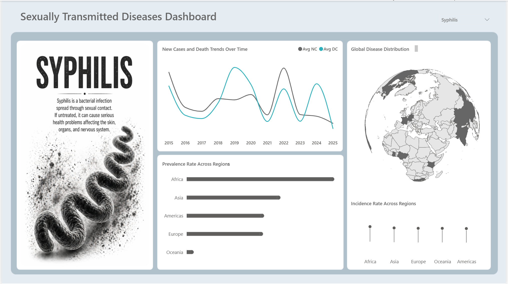
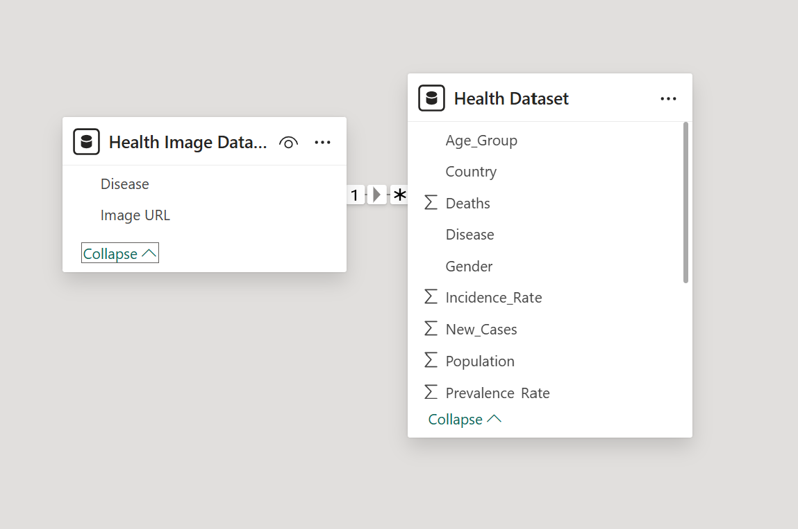
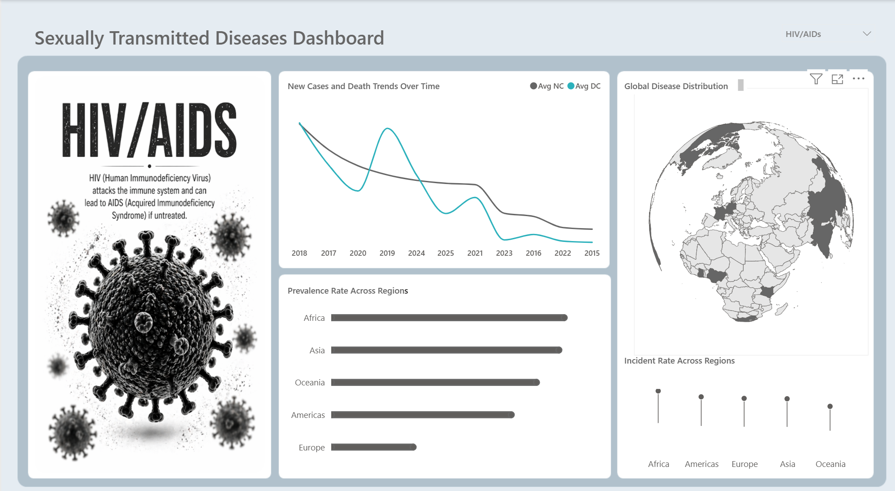
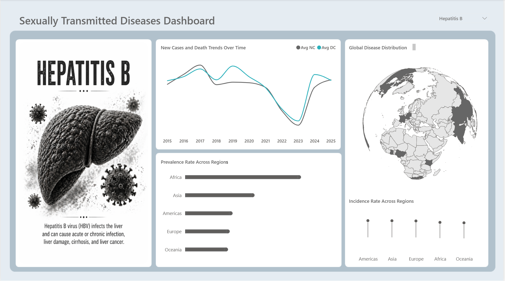
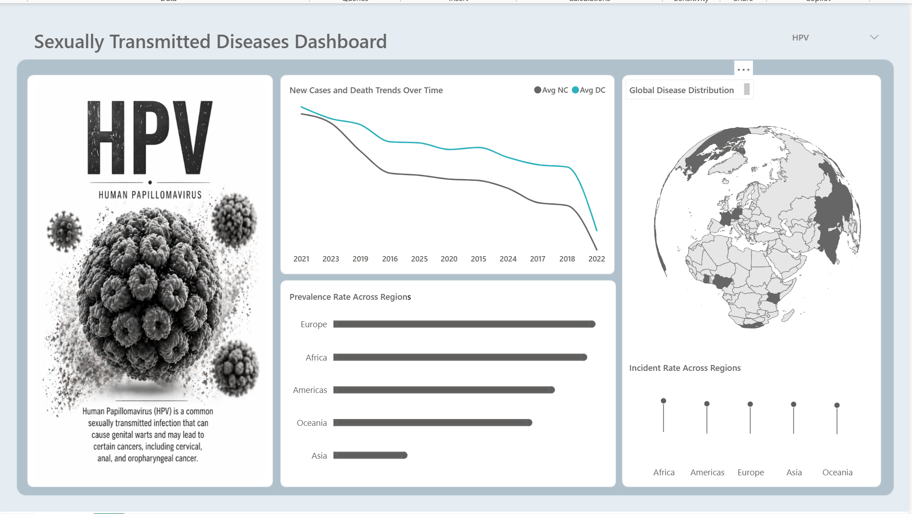

# STD Health Analysis

Comparing four sexually transmitted diseases across 14 countries and 5 world regions from 2015 to 2025, using an interactive Power BI dashboard.

**Tools:** Power BI · Power Query



## Table of contents

1. [Executive summary](#1-executive-summary)
2. [Project overview](#2-project-overview)
3. [Data source](#3-data-source)
4. [Problem statement](#4-problem-statement)
5. [Tools and methodology](#5-tools-and-methodology)
6. [Exploratory data analysis](#6-exploratory-data-analysis)
7. [Key insights](#7-key-insights)
8. [Dashboard preview](#8-dashboard-preview)
9. [Recommendations](#9-recommendations)
10. [Limitations](#10-limitations)
11. [Conclusion](#11-conclusion)
12. [Relevant links](#12-relevant-links)

## 1. Executive summary

This project analyses 819 records covering HIV/AIDS, Hepatitis B, HPV and Syphilis across 14 countries between 2015 and 2025. The most important step was a cleaning fix: 96 rows stored their percentages in a different format, which made them load 100 times too large and made Africa's average prevalence appear to be around 55% when the correct figure is about 3.2%. Once corrected, the data shows that **Hepatitis B carries the highest burden** (average prevalence 3.8%, incidence 446 per 100,000) and **Syphilis the lowest** (2.1%, 235 per 100,000). Differences between regions in prevalence are small, under one percentage point for every disease. The largest regional gap is in **treatment coverage**: about 67% in Africa compared with 88% in Oceania, and this gap appears for all four diseases. The data is a practice dataset, so these findings describe patterns in this data, not real world disease levels.

## 2. Project overview

**Domain:** public health and disease surveillance.

**Context:** sexually transmitted diseases are tracked with a small set of standard measures: how many people live with a disease (prevalence), how many new cases appear (incidence), how many people die, and how many receive treatment. Comparing these across diseases, regions and years shows where the burden is highest and where access to care falls short.

**Why it matters:** a planner looking at one number at a time can miss the bigger picture. A single page that shows trends, regional comparisons and geographic coverage for one disease at a time makes it quicker to spot where attention is needed, and easier to compare one disease with another.

## 3. Data source

The dataset was sourced from [Isaac Emmanuel](https://www.youtube.com/watch?v=pqScQQua0ls) on YouTube. It is a practice dataset rather than official surveillance data.

| | |
|---|---|
| **Rows** | 819 |
| **Columns** | 15 |
| **Diseases** | 4 (HIV/AIDS, Hepatitis B, HPV, Syphilis) |
| **Countries** | 14, across Africa, the Americas, Asia, Europe and Oceania |
| **Period** | 2015 to 2025 |
| **One row means** | One combination of year, country, disease, age group and gender |

A second file, `Health Image Dataset.csv`, links each disease to an image hosted on Google Drive, which the dashboard displays when that disease is selected.

### Data dictionary

| Column | Type in Power BI | Description |
| --- | --- | --- |
| `Year` | Whole number | 2015 to 2025 |
| `Country` | Text | Australia, Brazil, Canada, China, France, Germany, Ghana, India, Japan, Kenya, Nigeria, South Africa, UK, USA |
| `Region` | Text | Africa, Americas, Asia, Europe, Oceania |
| `Disease` | Text | HIV/AIDS (stored as "HIV/AIDs"), Hepatitis B, HPV, Syphilis |
| `Age_Group` | Text | 15 to 24, 25 to 49, 50+ |
| `Gender` | Text | Female, Male |
| `Population` | Whole number | Population of the group |
| `Total_Cases` | Whole number | People living with the disease |
| `New_Cases` | Whole number | New cases in that year |
| `Deaths` | Whole number | Recorded deaths |
| `Prevalence_Rate` | Percentage | Total cases as a share of the population |
| `Incidence_Rate` | Whole number | New cases per 100,000 people |
| `Tested_Population` | Whole number | Number of people tested |
| `Vaccinated_Population` | Whole number | Number of people vaccinated (recorded for HPV and Hepatitis B only, as these are the two with vaccines) |
| `Treatment_Coverage` | Percentage | Share of cases receiving treatment |

## 4. Problem statement

The project set out to answer four questions for each disease:

- **The trend:** how have new cases and deaths changed between 2015 and 2025?
- **Prevalence:** how does the share of people living with the disease compare across regions?
- **Incidence:** how does the rate of new cases compare across regions?
- **Coverage:** which countries does the data cover?

## 5. Tools and methodology

| Tool | How it was used |
|---|---|
| **Power Query** | Importing the two CSV files, setting data types and correcting the percentage format |
| **Power BI** | Data model, visuals and a single page interactive dashboard |

### Workflow

```
Raw CSV files → Import → Clean → Validate → Model → Dashboard → Insights
```

### Data collection

Both CSV files were imported into Power Query without changes. The raw files in the [`dataset`](dataset) folder are left exactly as they arrived, so every cleaning step can be seen and repeated in Power Query.

### Data cleaning and preparation

| Issue found | What was done |
|---|---|
| First row of each file holds the column names | Promoted to headers |
| All columns imported as text | Set to the correct types: whole number for counts, rates and year; text for categories; percentage for prevalence and treatment coverage |
| 96 rows store `Prevalence_Rate` and `Treatment_Coverage` without a percent sign (`3` instead of `3.00%`) | Power Query reads `3.00%` as 0.03 but `3` as 3, so these rows loaded 100 times too large. A transform step divides any value of 1 or more by 100 so every row uses the same scale |
| Missing values and duplicate rows | Checked: none found, so no rows were removed |

The percentage fix in Power Query:

```powerquery
#"Fixed Percentage Scale" = Table.TransformColumns(#"Changed Type", {
    {"Prevalence_Rate", each if _ <> null and _ >= 1 then _ / 100 else _, Percentage.Type},
    {"Treatment_Coverage", each if _ <> null and _ >= 1 then _ / 100 else _, Percentage.Type}
})
```

### Calculated fields and DAX measures

The report does not use DAX measures or calculated columns. Each visual uses Power BI's built-in **Average** aggregation:

| Visual | Calculation |
| --- | --- |
| New cases and deaths trend | Average of `New_Cases` (Avg NC) and `Deaths` (Avg DC) by `Year` |
| Prevalence rate by region | Average of `Prevalence_Rate` by `Region` |
| Incidence rate by region | Average of `Incidence_Rate` by `Region` |

### Data validation

- All 819 rows in the CSV loaded into the model.
- All four disease names in the main table match the image lookup table, so every row links to an image.
- After the percentage fix, `Total_Cases ÷ Population` equals `Prevalence_Rate` for all 819 rows. Before the fix, 96 rows failed this check, which confirms the fix corrected exactly the affected rows.

### Data modelling



Two tables joined by a single relationship: `Health Image Dataset[Disease]` (one) to `Health Dataset[Disease]` (many), filtering in one direction. The disease slicer uses the `Disease` column from the image table, so one selection filters the image and every chart on the page.

### Data visualisation

A single page dashboard built around one disease at a time, with a dropdown to switch between them. See [section 8](#8-dashboard-preview).

## 6. Exploratory data analysis

**How the measures relate.** The figures in this dataset are closely linked. Prevalence equals total cases divided by population, incidence equals new cases per 100,000 people, new cases are about 12% of total cases and deaths are about 5% of total cases in almost every row. This means the prevalence and incidence charts tend to tell a similar story.

**Distributions.** Average prevalence is 3.0% and average incidence is 351 per 100,000 across all records. Treatment coverage ranges from 55% to 90%, with an average of 78%.

**Coverage over time.** Each disease has between 8 and 14 countries recorded in any one year, and the number of rows per year ranges from 59 to 96. Year to year averages therefore mix slightly different sets of countries.

**Age groups.** Age group is tied closely to disease: 89% of HPV rows are for 15 to 24 year olds, while most HIV/AIDS, Hepatitis B and Syphilis rows are for 25 to 49 year olds. The 50+ group has only 61 rows in total.

**Gender.** Prevalence is almost identical for men and women for all four diseases (within about 0.1 percentage points).

**Missing values and outliers.** There are no missing values or duplicate rows. The only problem values were the 96 percentages stored in the wrong format.

## 7. Key insights

All insights describe **patterns in this dataset, not causes**, and the dataset is for practice rather than real surveillance.

**1. A formatting error was hiding the real picture.**
*What happened:* before cleaning, Africa's average prevalence appeared to be about 55%, and the prevalence chart showed Africa far ahead of every other region. After the fix, every region sits between 2.8% and 3.2%.
*Why:* 96 rows stored percentages without the percent sign, so they loaded 100 times too large.
*Why it matters:* the original chart's main message came from a data error, not from the data. Checking that rates add up (cases divided by population) caught it.

**2. Hepatitis B carries the highest burden and Syphilis the lowest.**
*What happened:* Hepatitis B has the highest average prevalence (3.8%) and incidence (446 per 100,000). HIV/AIDS (3.2%, 358) and HPV (3.1%, 364) are close together, and Syphilis is lowest (2.1%, 235).
*Why:* the ranking is the same on both measures, because they are closely linked in this data.
*Why it matters:* if resources had to be split across diseases, Hepatitis B would be the first place to look.

**3. Regional differences in prevalence are small.**
*What happened:* for each disease, the gap between the highest and lowest region is under one percentage point. Africa has the highest prevalence for HIV/AIDS (3.4%) and Oceania the lowest (2.7%), the widest gap of any disease.
*Why:* rates in this dataset cluster around a few fixed values (2%, 3% and 4%).
*Why it matters:* region alone is a weak guide for prioritising prevention in this data.

**4. Treatment coverage shows the clearest regional gap.**
*What happened:* average treatment coverage is 67% in Africa, 77% in Asia, 82% in the Americas, 84% in Europe and 88% in Oceania. The same order appears for all four diseases.
*Why:* the data does not explain the cause, but the gap is consistent across every disease.
*Why it matters:* this is a much larger difference than prevalence, which suggests access to treatment is a bigger regional issue than how common the diseases are. It is not currently shown on the dashboard.

**5. Hepatitis B prevalence dipped in 2022 and 2023.**
*What happened:* Hepatitis B prevalence is close to 4.0% in most years but falls to about 3.0% in 2022 and 2023, then returns to 4.0% in 2024. Average new cases fall from over 60,000 in most years to 37,000 in 2023.
*Why:* the data does not say. It could reflect a real change, a change in which countries reported, or the way the dataset was built.
*Why it matters:* a sudden dip followed by a full recovery is worth checking before it is read as progress.

## 8. Dashboard preview

One interactive page, built in Power BI:

| Visual | Type | What it shows |
| --- | --- | --- |
| Disease image | Image custom visual (CloudScope) | A custom image and short description of the selected disease |
| New Cases and Death Trends Over Time | Line chart | Average new cases and deaths for each year |
| Prevalence Rate Across Regions | Bar chart | Average prevalence rate for each region, highest first |
| Global Disease Distribution | Shape map (orthographic globe) | The countries with data for the selected disease |
| Incidence Rate Across Regions | Column chart styled as a lollipop chart | Average incidence rate for each region, highest first |
| Disease selector | Dropdown slicer | Filters the whole page by disease |

**Design:** a custom background, muted grey and teal palette and minimal on page text, so the visuals carry the story.

| HIV/AIDS | Hepatitis B |
| --- | --- |
|  |  |
| **HPV** | **Syphilis** |
|  |  |

## 9. Recommendations

**1. Focus on treatment access in Africa** (insight 4).
Treatment coverage in Africa is about 20 percentage points below Oceania for every disease, a far larger gap than any difference in prevalence. *Expected impact:* closing part of this gap would reach more people already living with a disease.

**2. Prioritise Hepatitis B among the four diseases** (insight 2).
It has the highest prevalence and incidence in every region. Vaccination is recorded for Hepatitis B, so vaccination and testing coverage are natural next measures to examine. *Expected impact:* attention goes to the disease with the largest burden.

**3. Check the 2022 and 2023 Hepatitis B figures before using them** (insight 5).
Confirm whether the dip reflects a real change or a change in reporting. *Expected impact:* avoids reporting a temporary drop as a lasting improvement.

**4. Always check that rates add up after loading data** (insight 1).
A simple check such as cases divided by population compared with the stated rate would have flagged the formatting error straight away. *Expected impact:* fewer misleading charts reaching an audience.

## 10. Limitations

- **Practice dataset.** The data is not official surveillance data, and its values follow fixed patterns, so findings should not be read as real disease levels.
- **Patterns, not causes.** The analysis shows where values are higher or lower, not why.
- **Simple averages.** Each visual averages rates across rows without weighting by population. Population weighted rates were checked and give the same rankings, but differ slightly in size.
- **Uneven coverage.** Not every country appears for every disease in every year, so year to year averages mix different countries.
- **Age groups tied to disease.** Most HPV rows are for 15 to 24 year olds and most other rows for 25 to 49 year olds, so age comparisons across diseases are not like for like.
- **Linked measures.** Prevalence, incidence, new cases and deaths are calculated from each other in this data, so they are not independent pieces of evidence.
- **Implicit measures.** The report uses Power BI's built-in averages rather than named DAX measures, which makes the calculations harder to reuse.

### Next steps

- Add a treatment coverage visual by region to the dashboard.
- Replace the built-in averages with named DAX measures, including population weighted rates.
- Show the number of countries reporting in each year alongside the trend chart.

## 11. Conclusion

The project compared four sexually transmitted diseases across regions and years, and its most useful finding came from cleaning rather than charting: a percentage formatting error had created a regional difference that did not exist. Once fixed, the data shows that prevalence is similar across regions, that Hepatitis B carries the heaviest burden of the four diseases, and that the clearest inequality is in access to treatment, with Africa well behind every other region. The value of the dashboard is a quick, one page view of each disease, and the next step is to add treatment coverage to it so that gap is visible at a glance.

## 12. Relevant links

| Link | Description |
|---|---|
| [GitHub repository](https://github.com/Orhmo/std-health-analysis) | All files for this project |
| [Power BI file](STD_dashboard.pbix) | The interactive dashboard (open in Power BI Desktop) |
| [Health Dataset.csv](dataset/Health%20Dataset.csv) | Main dataset (raw) |
| [Health Image Dataset.csv](dataset/Health%20Image%20Dataset.csv) | Disease image lookup table |
| [Dataset source](https://www.youtube.com/watch?v=pqScQQua0ls) | Isaac Emmanuel on YouTube |

### Repository structure

```
std-health-analysis/
├── README.md
├── STD_dashboard.pbix              Power BI report
├── dataset/
│   ├── Health Dataset.csv          main dataset (819 rows, 15 columns)
│   └── Health Image Dataset.csv    disease image lookup table (4 rows)
└── Powerbi_Screenshot/
    ├── HIV_AIDS.png                dashboard filtered to HIV/AIDS
    ├── HepatitisB.png              dashboard filtered to Hepatitis B
    ├── HPV.png                     dashboard filtered to HPV
    ├── Syphilis.png                dashboard filtered to Syphilis
    └── model.png                   data model view
```

### How to reproduce

1. Clone or download this repository.
2. Open `STD_dashboard.pbix` in Power BI Desktop.
3. Go to **Transform data > Data source settings** and point both sources to the files in the `dataset` folder, then select **Refresh**.
4. Check the cleaning worked: with Syphilis selected, every region in the prevalence chart should show about 2%.
5. Use the dropdown at the top right to switch between diseases.

The disease images load from Google Drive, so an internet connection is needed for them to display.

### Author

**Orhmo**
